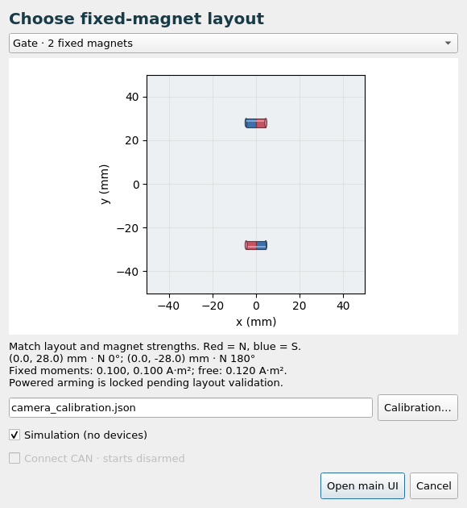
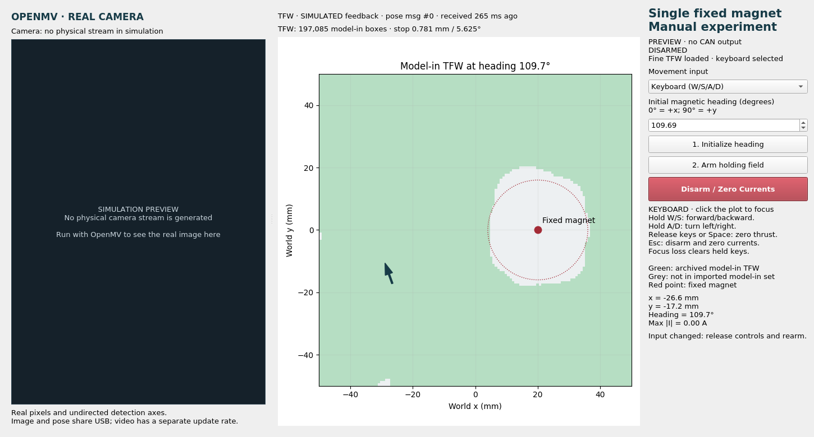
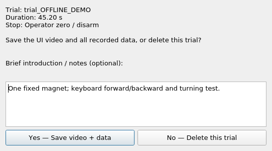
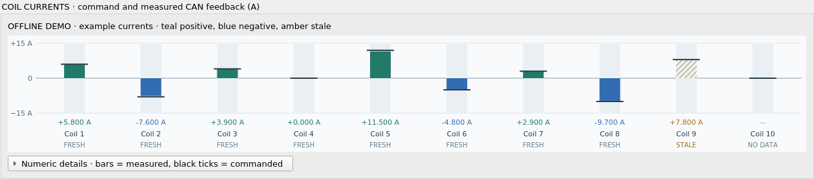
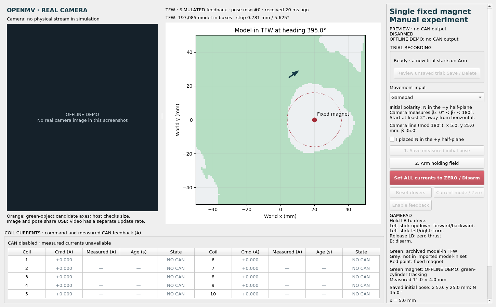

# Case Study 1: Single, Gate and Triangle layouts

For step-by-step bench instructions, start with [RUN_EXPERIMENT.md](RUN_EXPERIMENT.md).

One shared controller/UI supports one free magnet with **Single (1 fixed)**,
**Gate (2 fixed)** or **Triangle (3 fixed)** magnets. Each case has its own matching
TFW, fixed-dipole model, configuration and trial metadata. The camera calibration,
keyboard controls, current bars and Save/Delete workflow are shared. The package
keeps its original ROS name for compatibility; Case 8 remains separate.

## Choose the case at startup

From the workspace root:

```bash
source /opt/ros/noetic/setup.bash
source .venv/bin/activate
source devel/setup.bash
rosrun case_study1_single_fixed_magnet main.py
```

Choose the layout, check its fixed positions/polarities and select calibration.
**Simulation** uses no devices; **Connect CAN** opens the hardware connection but
starts disarmed. Then click **Open main UI**. The selector defaults to camera-only
operation with CAN disabled. Close the current experiment (resolving any trial)
before choosing another case; closing the main UI stops its ROS launch. A second
launcher refuses to start while `/cs1_controller` is already running.

To choose a simulated case directly:

```bash
rosrun case_study1_single_fixed_magnet main.py --layout gate --preview
roslaunch case_study1_single_fixed_magnet preview.launch layout:=triangle
```

For a camera/CAN run, use `main.py --layout gate --hardware --calibration <file>`
or `experiment.launch layout:=gate hardware:=true calibration:=<file>`. New Gate
and Triangle configurations have **both controller hardware-validation flags
false**, so powered arming is locked. Existing Single tuning/flags are preserved;
selecting a case does not validate hardware or permit changing those flags.

| Layout | Fixed centers (mm) | N headings | Fixed moments (A·m²) | TFW boxes |
|---|---|---|---|---|
| Single | (20, 0) | 90° | 0.145 | 197,085 |
| Gate | (0, 28); (0, −28) | 0°; 180° | 0.100 each | 233,613 |
| Triangle | (0, 30); (−25.981, −15); (25.981, −15) | 0°; 120°; 240° | 0.075 each | 259,771 |

The plane is z = 82 mm and the free moment is 0.12 A·m² in all three source
models. Match the physical magnet strengths as well as their positions and
polarities; magnet count alone is insufficient. Interaction force and torque
sum over **all** fixed magnets, and clearance is checked against **each** one.

Gate/Triangle configs are in `config/layouts/`; checked assets/provenance are in
`data/layouts/`. Their default results go to `results/gate/` and
`results/triangle/`; Single retains `results/`. Each saved trial records its
layout, configuration, calibration and matching source hashes.

To refresh a dataset, using the workspace project's fine results:

```bash
python src/case_study1_single_fixed_magnet/scripts/import_tfw.py <Workspace_eMNS-main> --layout gate
python src/case_study1_single_fixed_magnet/scripts/import_tfw.py <Workspace_eMNS-main> --layout triangle
```

The importer checks the task, coil parameters and every fixed pose/moment before
replacement. Do not swap an asset alone or change a model without matching TFW.



[Gate UI preview](docs/gate_panel.png) · [Triangle UI preview](docs/triangle_panel.png)



## Physical setup and coordinates

The default model matches the paper's single-fixed-magnet simulation:

| Quantity | Default |
| --- | --- |
| Support plane | World `z = 0.082 m` |
| Fixed magnet center | World `(x,y) = (0.020,0.000) m` |
| Fixed magnet magnetic heading | `+90 deg` (toward world `+y`) |
| Fixed / free dipole moment | `0.145 / 0.12 A m^2` |
| Complete equilibrium task | Body `[By,Bz,fy,fz] = [0,0.02 T,0,±0.1 N]` |
| Ten coil current bounds | `±15 A` |
| Manual full-stick thrust | `0.025 N` |
| Turn command rate | `0.35 rad/s` |
| Minimum center separation | `16 mm`, plus uncertainty/prediction margin |

Heading `0 deg` is world `+x`; `90 deg` is world `+y`. Body `z` points along
the free magnet's dipole in the support plane; body `y` is its lateral axis.
The fixed magnet must be mechanically secured: no output is allocated to it.

The coil coordinates use the paper's shifted frame. **Do not substitute the
older Case 6 ROS coordinates (`z = 0`) or reuse Case 8 laser calibration.**
Check actual coil registration, plane height, fixed-magnet pose, magnetization
direction, and moments against this setup. `config/experiment.json` contains
the parameters. A model change invalidates the imported TFW; the loader refuses
to pair modified model parameters with the old data. Recompute and import the
corresponding workspace before using a different arrangement.

`data/tfw_single_fixed.npz` contains 197,085 model-in boxes copied from the
workspace project's `revised_case_studies/results/cs1/tfw3d_fine/tfw3d_single.json`.
This is the current fine corrected-`dBy/dy` result, with stopping widths
0.78125 mm in x/y and 5.625 degrees in heading. Provenance,
source hashes, protocol, and coil parameters are in `data/provenance.json`.
No runtime dependency on the other research folders is required.

The earlier 28,231-box dataset and its provenance are preserved under
`archive/tfw/cs1_single_fixed_cb70fe3f55a8/` in the ROS_CAN workspace.
Both the controller guard and the UI load the new asset on startup; restart
an existing launch to use the update.

To import a later matching fine single-layout result, run from ROS_CAN:

```bash
python src/case_study1_single_fixed_magnet/scripts/import_tfw.py /path/to/Workspace_eMNS-main
```

The importer verifies the task, coil model, fixed-magnet layout, domain and
current limits before replacing data. It archives the preceding asset,
copies source boxes exactly, and records source and imported-asset hashes.
The loader checks the imported checksum and box count. A TFW generated for a
different physical model is rejected rather than applied to this controller.

## Build and preview

Run from the ROS_CAN root:

```bash
source /opt/ros/noetic/setup.bash
source .venv/bin/activate
catkin_make
source devel/setup.bash
roslaunch case_study1_single_fixed_magnet preview.launch
```

Preview uses a simulated magnet and opens no CAN interface or camera. It uses
the real USB gamepad when connected. The preview plant is frozen while disarmed
to make setup convenient; this behavior is not a model of an unpowered magnet.

The experimental **pose hold** controller and the field-steering controller have
separate validation flags. New Gate/Triangle configs keep both false following
the earlier uncontrolled startup motion. Keep new-case flags false until coil order/polarity, measured field
and force response, gains, startup behavior, and the expanded task family have
been validated. Software tests and fresh current reports do not validate force.
The imported TFW certifies the original forward-force family; the new lateral
position corrections are **not** covered by that certificate. The displayed TFW
is retained as a geometric exclusion guard, not a proof of closed-loop stability.

Arm captures the measured x/y/heading reference at zero command current, then
ramps the coordinated ten-coil vector at at most 0.5 A/s per coil (0.05 A per
10 Hz tick); independent per-coil clipping is not used. Movement input is
inhibited during startup. Position feedback uses a filtered PD correction with a
1 mm deadband, corrective-force target capped at 5 mN, and a heading field referenced to the captured
EM heading rather than following camera jitter. These are uncommissioned
settings, not measured stable hardware gains. Startup stops on >3 mm displacement,
excess heading change, or timeout. Normal holding stops on >4 mm reference error.
Current ramping alone cannot guarantee a stationary magnet or correct a model
polarity error. Pose target/error, velocity and target task are in controller
events and telemetry CSV; a blue cross in the plot marks the reference. During
startup the permanent-magnet force is not fully cancelled until the holding
currents are established. A slow ramp is not by itself a stationary-start proof.

Default controls (axis/button numbers vary between gamepads):

- Left stick up/down: advance/reverse the position target at up to 2 mm/s.
- Left stick left/right: turn the heading target.
- Hold LB (button 4) to enable stick commands. Release once after connecting.
- Release LB or center the stick: freeze the target and continue pose correction.
- B (button 1) or **Disarm / Zero Currents**: disarm and send zero currents.

### Keyboard control

Select **Keyboard (W/S/A/D)** in the panel's **Movement input** selector, then
release the keys and rearm. Click the plot so the panel has keyboard focus.
Hold W/S for forward/backward and A/D for left/right turning; combinations
such as W+A work. Release the keys or press Space to freeze the target and hold.
Esc disarms and requests zero currents. Losing focus clears held movement keys;
typing in an input field does not drive the magnet. Holding the target can still
require corrective force and current; disarming requests zero currents.

To start a keyboard-only preview without a gamepad:

```bash
roslaunch case_study1_single_fixed_magnet preview.launch input_source:=keyboard gamepad:=false
```

For a real-camera launch, use the same `input_source:=keyboard gamepad:=false`
arguments with `experiment.launch` and your calibration/hardware arguments.
Switching input sources disarms and clears the old command; rearm with neutral
controls. The controller accepts only the selected input, so a connected
gamepad cannot override keyboard movement. Keep the panel open for keyboard
control; closing it disarms, and a lost keyboard heartbeat also disarms.

The GUI shows the live OpenMV image alongside the heading-dependent TFW,
fixed magnet, measured free-magnet heading, trail, controller state, and peak
commanded current. Use **Initialize heading**, release
the deadman/sticks, then **Start holding** in simulation. Arming starts at
zero command current and ramps toward pose hold. A fresh neutral selected-input
heartbeat is required to arm. Powered arming remains locked pending validation.

Remap a real experiment with launch arguments `joy_device`, `axis_drive`,
`axis_turn`, `deadman_button`, and `stop_button`, for example:

```bash
roslaunch case_study1_single_fixed_magnet experiment.launch \
  joy_device:=/dev/input/js0 axis_drive:=4 axis_turn:=3
```

This command uses the real camera but still has CAN disabled. The node's
private `drive_sign`, `turn_sign`, and `deadzone` parameters provide further
gamepad adjustments. Preview defaults to the left stick; to remap preview,
use `experiment.launch simulate:=true` with the same arguments.

## Record one complete control trial

Click **Start holding** normally: the UI prepares the video encoder and data
files before the first nonzero holding command. A red **Recording**
banner shows elapsed time. Every arming creates a separate trial. Failed setup
cannot silently enable control without a ready recorder. UI recording needs the
main panel; `record_ui:=false` is an explicit data-only option for headless tests.

Recording stops on **ZERO / Stop**, Esc/gamepad stop,
tracking/input loss, reset/current-mode operations, or window close. Once writers
finish, the UI asks **Save this control trial?**:

- **Yes — Save video + data:** add optional notes; keep the whole folder under
  `results/trial_<date>_<time>_<unique-id>/`, with an automatic `README.md`
  introduction and your notes.
- **No — Delete this trial:** remove only this trial's temporary folder, including
  its video, telemetry, events and camera images. Previously saved trials,
  calibration and pre-run initial-pose references are untouched.

Closing the dialog without choosing keeps the trial pending. Use **Review
unsaved trial: Save / Delete** to return to it. Resolve it before arming again.
Closing the main window while active first disarms and offers the same choice.
Interrupted runs remain in `results/.pending/` for review/recovery at next
startup; they are never automatically discarded. A recovered video may be partial.

Each saved folder contains:

| File | Contents |
|---|---|
| `ui.avi` | Full main window: camera, TFW/pose, controls, currents; MJPEG at 5 fps |
| `video_timestamps.csv` | Frame/capture times and duplicated frames |
| `video_complete.json` | Codec settings, capture/drop counts, errors |
| `telemetry.csv` | UTC/elapsed time, pose, wrapped/unwrapped heading, input, state, 10 commanded currents, 10 measured currents and freshness |
| `events.jsonl` | Received pose/heading/tracking/input events and every received CAN current report during the trial |
| `camera/` | Original received JPEG previews, indexed by timestamped events |
| `session.json` | Start/stop/reason, actual pose at arming, initial reference, calibration, model/configuration and TFW provenance |
| `README.md` | Brief introduction, duration, stop reason, counts and optional notes |

Missing current feedback stays null/blank. Times use host UTC and a shared host
monotonic clock; UI video is a 5 fps display recording, not hardware-synchronized
camera acquisition. Video resizes are letterboxed; dropped capture requests are
reported, and frame repeats preserve elapsed playback time. MJPEG favors simple,
reliable capture over small file size. OpenCV is the encoder dependency.

Data and video use bounded worker queues. A data-write error or lost UI-recorder
heartbeat disarms; partial files remain available for review. The GUI never
blocks control callbacks on disk/video encoding. Recording services live under
`/cs1/recording/`: `prepare`, `video_ready`, `video_done`, `cancel` (Trigger), and
`resolve` (SetBool: true Save / false Delete). `/cs1/recording/state` is a latched
JSON state stream. `results_dir:=...` selects a different recording root.



## Driver controls and measured coil currents

The main panel includes **Reset**, **Current mode**,
**Feedback**, and **ZERO / Stop**. Reset and mode
preparation cancel in-flight arming and leave the controller disarmed. Reset
sends zero first, then the legacy reset packet; it resets CAN drivers, not the
camera calibration or saved initial pose. Mode preparation selects current mode
and zero output. Arming remains a separate action with the existing checks.
From idle, mode preparation matches the legacy sequence: standard ID `0x001`
with `02 55 55 55 55 55 55 55`, a 0.5 s wait, then ID `0x003` with
`13 88 00 00 55 55 55 55`. Feedback is requested separately using **Enable
feedback**. Uninitialized tracking does not repeatedly send zero-current packets
while disarmed; loss of tracking during control still zeros output and disarms.
If a driver buzzer sounds, stop and inspect its fault indicator before another
mode or arming attempt; a successful CAN send is not a driver acknowledgement.
Hardware arming requires prepared current mode and fresh measured reports from
all ten drivers. Arm keeps that prepared mode instead of switching it again.
Loss of current feedback during a run disarms. The latest run-stop reason stays
in memory and in the panel after Save/Delete, until the controller restarts.

The zero button sends the broadcast zero command and an explicit zero to all
ten driver IDs, including before arming. Success means commands were sent;
measured current feedback is needed to confirm the physical response. These
operations run off the Qt thread so key releases and GUI updates keep working.

The bottom display shows **all ten coils as signed current bars** on the same
−15 to +15 A scale. Positive measured current fills upward in teal; negative
fills downward in blue. Black ticks show commanded current, with measured values
and channel states underneath. Amber hatching identifies stale feedback; missing
feedback has no filled bar. **Numeric details** expands the full table with
separate commanded amperes, measured amperes, per-coil report age and
FRESH / STALE / NO DATA / NO CAN status. Table rows are paired as coils 1–5 and
6–10 to keep every coil visible. Staleness uses a
1 s threshold and includes time since the UI's last controller message. A stale
measurement retains its historical value and is marked stale; missing data is
shown as a dash, never a fabricated zero. Hover a coil for its CAN IDs.



Feedback uses the existing driver IDs `0x01B` through `0x0AB`, stepping by `0x10`,
and signed big-endian 16-bit milliamps in the first two bytes. **Feedback**
sends the same `0x00A` request as the old UI; arming/current-mode preparation also
enables reporting. `/cs1/current_feedback` is a JSON String with ten nullable
`values_A`, per-channel `age_s` and `fresh` arrays, availability and error state.
The controller's status embeds the same data, and its CSV appends measured
current and age columns. `/cs1/currents` still means commanded current.

Services (Trigger): `/cs1/zero_currents`, `/cs1/reset_drivers`,
`/cs1/prepare_drivers`, and `/cs1/enable_current_feedback`. With `hardware:=false`,
the zero button clears simulated/commanded output; driver controls stay disabled
and real current feedback remains unavailable. The GUI never opens its own CAN
connection; the controller owns the bus and receives feedback in a worker.

## Camera line tracking and initial heading

### Real camera and feedback-driven world view

The TFW view draws the fixed magnet half red (N) and half blue (S), and the free magnet in green, as cylinders
with a 10 mm length and 4 mm diameter, to scale on the millimeter axes. Their
orientation follows the configured fixed heading and measured free heading;
the free magnet's arrow shows polarity. No text is drawn on either magnet. Stale free poses are faded. Before initialization,
a fresh detected axis is shown without a polarity arrow. These are display
dimensions only; the detector's 11 mm nominal size and imported TFW are unchanged.

The main UI opens maximized. The right panel keeps short controls, a two-line
keyboard guide, live pose and tracking status. Expand **Details** for measured
magnet size, initial pose, target pose, tracking-loss diagnostics and the full
model-force breakdown. Long explanations are available as tooltips.
The displayed total in-plane force includes both sources:
`F_total = F_coils + F_fixed`. Total torque about the plane normal is
`tau_total = m_free × (B_coils + B_fixed)`. **Details** separates coil and fixed
force/torque contributions; even with zero coil current, fixed-magnet interaction
remains. These are dipole-model estimates using commanded currents, not measured
forces or torques. The allocator also includes the fixed interaction as its
offset when solving for the coil currents.
With the saved pixel-to-EM calibration, the camera
pane rectifies x and y from −50 to +50 mm into a square, with +x right and +y up,
matching the TFW view. It preserves the square aspect ratio when resized; dark
areas indicate coordinates outside the captured image. The transform affects
only the displayed image, not detector inputs or the saved raw camera frames.

The left pane displays JPEG previews from the same OpenMV USB stream as the
pose measurements. The middle pane draws the free magnet directly from
`/cs1/pose` and selects the TFW slice from that measured heading. It does not
integrate a separate predicted magnet trajectory during a physical run.
The camera preview can appear before heading initialization and remains
available when no acceptable cylinder is detected, so you can inspect the scene.

Upload the updated `scripts/openmv_code.py` to enable images. No second serial
connection, OpenMV IDE connection, or `cv_bridge` dependency is used. The defaults
are a 320×240 RGB color image, JPEG quality 40, and at most one preview every
200 ms (5 Hz nominal maximum). Pose detections are sent on every camera loop.
Detection overlays are drawn only after blob measurements are taken.

Camera and pose ROS message counters and arrival ages are displayed independently.
The counters are assigned by separate ROS publishers and do not identify a
common capture instant.
The video is rate-limited, so it may show an earlier frame than the newest TFW
pose. Arrival age means time since reception on the host; it is not a calibrated
camera-to-screen latency. Images older than one second are marked **STALE**;
tracking loss/stale pose has its own indication and controller watchdog.
An invalid JPEG is rejected without suppressing a valid pose packet. A partial
USB line is skipped while preserving subsequent complete packets; bounded
freshness and motion checks still govern pose validity.

If preview transfer slows tracking on your board, increase `PREVIEW_PERIOD_MS`,
lower `JPEG_QUALITY`, or set `SEND_PREVIEW=False`, then upload/restart. Physical
frame rate and USB bandwidth still need measurement on the actual camera.
The simulation-only preview deliberately leaves the camera pane empty and
labels the world pose as simulated feedback; it does not invent a real image.

The OpenMV code detects the **physical green coating** in LAB color space and
sends centroids, undirected long-edge axes (with the moment axis retained for diagnostics), green pixel counts, and rotated bounding
corners. Tune `GREEN_THRESHOLD`, `ROI`, exposure, and shape/area limits in
`scripts/openmv_code.py` for the current lighting. Orange preview marks are
candidate axes, not proof that the host accepted the object.

The current green threshold uses LAB a <= -10 and merges intersecting blob
boxes to retain dim, disconnected parts of the coating. Host size and identity
checks still apply. The USB reader preserves partial packets when more bytes
arrive during a read; continuous camera traffic must not reset initialization.

The host maps the rotated corners through the measured affine calibration and
checks the **11 mm length / 4 mm diameter**. Current acceptance ranges are 7–15 mm
length, 2–6 mm diameter, aspect 1.5–5.5, plus elongation and axis/box agreement.
These tolerances allow segmentation and pixel errors; they are not a calibration
accuracy guarantee. Change them in `config/experiment.json` under `tracking`.
The host also excludes the fixed magnet, rejects multiple nearby candidates,
checks position/angle continuity, and requires three stable observations before
initialization. Old dark-silhouette camera scripts are rejected explicitly.

A line has a 180-degree ambiguity. Place N in the **+y half-plane**, confirm that physical polarity in the GUI,
and initialize using the measured line angle. The tracker
chooses the line direction in (0, π), then unwraps headings
continuously. The half-plane confirmation must identify the correct pole direction; a geometrically
identical 180-degree reversal cannot be detected from the silhouette alone.
Frame-to-frame rotation must remain below 90 degrees; the configured jump
limit is stricter. A prolonged detection loss, ambiguous candidates, camera reconnection,
or a heading jump requires initialization again and controller rearming.

For the start pose, point **N anywhere into the EM +y half-plane**, so the
measured direction satisfies **0° < β₀ < 180°**. It need not point exactly +y.
The main UI shows the camera's measured x/y/β₀; there is no manual angle entry.
Check **I placed N in the +y half-plane**, wait for stable detection, then click
**Set start pose**. The tracker selects the undirected line's branch
in (0, π) and saves that measured angle. Starts within 3° of horizontal are
rejected (configurable `tracking.initialization_boundary_margin_rad`), because
the branch choice is unreliable near the half-plane boundary. The confirmation
clears after a successful save; arming remains a separate action.

The tracker maintains an unwrapped angle through repeated full rotations, in
either direction. For example, 90 → 180 → 270 → 360 → 450 degrees records a full
turn from the initial pose. `/cs1/pose` quaternions describe orientation modulo
2π; `/cs1/heading_unwrapped` (Float64, radians) preserves accumulated turns and
the panel displays that continuous value while fresh. Aliasing cannot be resolved
from a symmetric line if the magnet rotates 90° or more between reliable
observations. The rate/jump gates reject observable inconsistencies, but cannot
prove that an unseen half-turn did not occur. A prolonged loss, ambiguity, a camera reset,
or an implausible jump requires a known-polarity initialization again.

Each initialization creates a pre-run reference under
`results/initial_poses/initial_pose_<timestamp>.json`, with world position,
measured N heading, calibration matrix, detector, measured dimensions and camera
sequence. `/cs1/initial_pose_metadata` publishes the same reference latched.
The per-run recorder snapshots it when arming. The old continuously written
tracking CSV is disabled in the standard launch, preventing duplicate run data
from remaining after a trial is deleted (`~legacy_tracking_log` is available
for standalone diagnostics).

A short segmentation miss (≤120 ms) marks feedback invalid and publishes no
pose, while retaining the polarity branch briefly for bounded-rate reacquisition.
The controller still disarms on invalid feedback. Longer gaps or ambiguous
identities require reinitialization. `/cs1/initial_pose` remains the most recent
latched reference, so tracking validity must still be checked.



The affine calibration transforms both centroid and line direction, including
camera axis swaps/reflections. Obtain at least four well-spread measured points
on the support plane in the **coil world frame**, and save a JSON list:

```text
[[pixel_x, pixel_y, world_x_m, world_y_m], ...]
```

For interactive calibration, run this standalone window first (no existing
mapping or ROS master required):

```bash
.venv/bin/python src/case_study1_single_fixed_magnet/scripts/camera_calibration_ui.py --port /dev/ttyACM0
```

The color camera view is rotated 90° counterclockwise in both UIs. Calibration
clicks still report original camera pixels, so the tracker mapping stays consistent.
Detection uses the green coating in LAB color space before preview overlays are drawn.

Connect, click references, enter EM coordinates in **mm**, fit, check unused
points and known magnet headings, then save. Close it to release USB and pass
its saved JSON path to `experiment.launch calibration:=...`. See section 5 of
`RUN_EXPERIMENT.md` for the full workflow. The same affine map transforms the
magnet axis; its 180° polarity branch still needs manual initialization.

For point lists, fit a new calibration (the output filename must not already exist):

```bash
rosrun case_study1_single_fixed_magnet calibrate_camera.py \
  measured_points.json src/case_study1_single_fixed_magnet/config/measured_camera.json
```

Inspect the reported fit errors and check additional independent points and
known directions. Keep the error below the configured position margin; increase
that margin if needed. The shipped `camera_calibration.json` deliberately has
no invented calibration and must be replaced or overridden with `calibration:=...`.

## Edit and upload from VS Code

Disarm the experiment, stop the tracker/launch, and disconnect OpenMV IDE or
other serial monitors. Edit `scripts/openmv_code.py`, then run the VS Code task
**CS1 OpenMV: Upload and Restart**, or from the workspace root:

```bash
.venv/bin/mpremote connect /dev/ttyACM0 fs cp \
  src/case_study1_single_fixed_magnet/scripts/openmv_code.py :main.py + reset
```

The port is configurable in the task prompt. Use **CS1 OpenMV: Monitor Output**
for JSON output; exit with Ctrl-X before restarting the tracker. No cable
reconnection is required in normal operation. Board/firmware communication
must still be verified on the actual camera.

## Real feedback and CAN output

First run camera feedback with CAN disabled:

```bash
roslaunch case_study1_single_fixed_magnet experiment.launch \
  calibration:=$(pwd)/src/case_study1_single_fixed_magnet/config/measured_camera.json
```

Check the measured position, magnetic heading, axis signs, TFW overlay, and
gamepad mapping. Configure the existing SocketCAN interface for the actual
driver bitrate and confirm its channel (normally `can0`). After stopping the
preview launch, start CAN-enabled operation explicitly:

```bash
roslaunch case_study1_single_fixed_magnet experiment.launch hardware:=true \
  can_channel:=can0 port:=/dev/ttyACM0 \
  calibration:=$(pwd)/src/case_study1_single_fixed_magnet/config/measured_camera.json
```

The controller starts disarmed, sends mode/current initialization on arming,
and uses the existing ten-coil CAN IDs and signed milliamp payload format.
Hardware mode rejects the simulated-feedback launch configuration.

## Guard behavior and evidence limits

The guard checks the **original box union**, not the display raster, and covers
the full configured position/heading uncertainty neighborhood. It also checks
a conservative swept neighborhood based on the commanded turn, measured speed,
nominal drive speed, and prediction horizon. A boundary-crossing request is
replaced by the zero-thrust holding task. Measured departure, stale tracking,
lost gamepad heartbeat, or an unacceptable allocation residual disarms the node.
The current allocation is checked again after milliamp quantization; current
bounds and subsequent slew bounds are enforced.

This is a model-based command guard, not a physical invariant fence. Friction,
inertia, tracking/calibration error, and unmodeled interactions can still cause
departure. Turning uses a small transverse field to change heading, so the
transient task differs from the paper's equilibrium `By = 0` requirement; its
individual current allocation is checked separately. The archived affine backend
is not outward-rounded throughout, so the green set is labeled **model-in**,
not an unconditional hardware certificate. Zero coil currents do not cancel
the permanent fixed magnet's attraction and do not physically stop motion.

Topics: `/cs1/pose` (PoseStamped, meters and quaternion, `emns_world`),
`/cs1/tracking_valid` (Bool), `/cs1/command` (Twist, selected normalized drive/turn),
`/cs1/currents` (Float64MultiArray, amperes), `/cs1/status` (JSON String), and
`/cs1/fps` (Float32). Tracking also publishes `/cs1/heading_unwrapped` (Float64),
`/cs1/initial_pose` (latched PoseStamped), and `/cs1/tracking_status` (JSON String).
Input publishers use `/cs1/gamepad_command` and
`/cs1/keyboard_command`; `/cs1/input_source` selects `gamepad` or `keyboard`.
Camera previews use `/cs1/camera/image/compressed` (`sensor_msgs/CompressedImage`, JPEG).
Services: `/cs1/initialize_heading` (Trigger) and
`/cs1/arm` (SetBool). Per-arming trial folders are reviewed and saved under
`results/`; see the recording workflow above. Existing legacy logs are preserved.

## Validation

```bash
python -m unittest discover -s src/case_study1_single_fixed_magnet/tests -v
python src/case_study1_single_fixed_magnet/tests/ros_smoke.py
```

The ROS smoke test starts an isolated preview master, tests arming, drive/turn
motion and command timeout, then shuts its processes down. It opens no hardware.
`tests/paper_reference.json` contains matrices generated by the independent
paper implementation `emns/workspace/fast.py`, with its source hash recorded in
`data/provenance.json`. Physical camera detection, gamepad mappings, calibration,
CAN delivery, and magnet motion require on-bench validation.

OpenMV line-axis semantics are described in the
[official image API](https://docs.openmv.io/library/omv.image.html), and upload/
reset commands in the [official mpremote guide](https://docs.openmv.io/dev/reference/mpremote.html).
