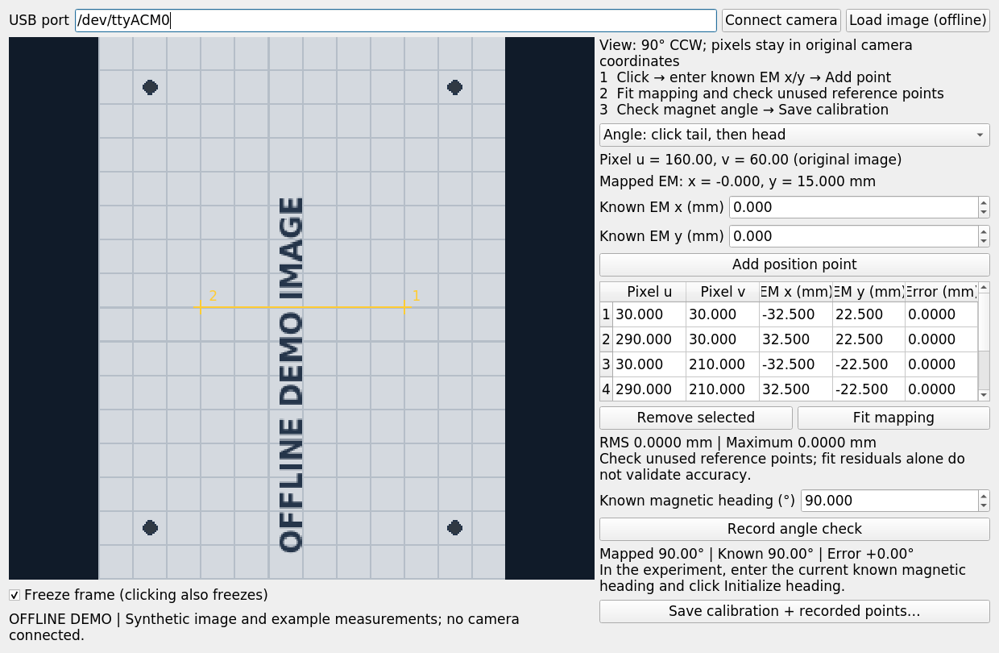

# Run Case Study 1: Single, Gate or Triangle

Start the shared layout selector after sourcing ROS, `.venv`, and the workspace:

```bash
rosrun case_study1_single_fixed_magnet main.py
```

Select **Single · 1**, **Gate · 2** or **Triangle · 3** fixed magnets, match the
physical arrangement shown, choose calibration, and open the main UI. Use
**Simulation** to inspect a case without devices. Close the current experiment
and resolve its trial before changing cases. See the README for layout positions,
headings, strengths and direct launch commands. Gate/Triangle use separate
configs, TFW assets and result folders; every trial stores the selected layout.

Use this guide at the bench. It covers first-time setup and the shorter routine
for later runs. The experiment uses a USB gamepad to drive a free cylindrical
magnet forward/backward and turn it, with position and heading measured by OpenMV.
Keyboard control is also available; see the keyboard instructions below.

**New Gate/Triangle hardware arming is locked pending physical validation.**
The existing Single settings are preserved. Do not mark either new controller
configuration hardware-validated until the physical force model, controller gains
and startup have been validated. The original forward-force TFW does not certify
the added lateral position-correction forces. The instructions below describing
powered runs apply only after that validation. Camera/CAN feedback can stay on
while disarmed without permitting Arm.

The controller and TFW plot use the latest imported single-layout fine CS1
workspace: 197,085 model-in boxes, with stopping widths 0.78125 mm and 5.625°.
After a data update, stop and restart the launch to load it in both nodes.
See the package README for the checked import command and dataset provenance.

## 1. Prepare the terminal

Open the ROS_CAN folder in VS Code, then open its terminal. Run these commands
from the workspace root:

```bash
source /opt/ros/noetic/setup.bash
source .venv/bin/activate
catkin_make
source devel/setup.bash
```

For each additional terminal, run the three `source` commands again. You only
need to rebuild after code or package changes. `roslaunch` starts a ROS master
if one is not already running; you do not need a separate `roscore` terminal.

## 2. Try the gamepad in preview first

Connect the USB gamepad, then run:

```bash
roslaunch case_study1_single_fixed_magnet preview.launch
```

This uses a simulated magnet and does not open CAN or the OpenMV camera.
The camera pane therefore shows a simulation placeholder; the middle pane shows
the simulated feedback pose and its TFW. It will show a real image when you run
with the physical camera and upload the updated camera script.

In the control panel:

1. Check that the mode says **PREVIEW · no CAN output**.
2. Release both sticks and LB. The gamepad must send a neutral command to arm.
3. Click **Initialize heading**. In preview, the simulated heading is already known.
4. Click **Start holding**.
5. Hold LB and gently move the left stick.

| Input | Action |
| --- | --- |
| Left stick up / down | Forward / backward along the magnet's heading |
| Left stick left / right | Turn left / right |
| Hold LB | Allow stick commands |
| Release LB | Zero commanded thrust and maintain the heading field |
| B or **Disarm / Zero Currents** | Disarm and request zero coil currents |

The defaults are drive axis `1`, turn axis `0`, LB button `4`, and B button `1`.
These numbers can differ on your gamepad. Check them in preview before running
the physical experiment. The arrow points along the magnetic heading; green
shows the TFW slice for that heading. A boundary warning means the controller
has replaced the movement request with its holding task.

If another stick is needed, stop with Ctrl-C and run, for example:

```bash
roslaunch case_study1_single_fixed_magnet experiment.launch \
  simulate:=true axis_drive:=4 axis_turn:=3 deadman_button:=4 stop_button:=1
```

To inspect the normalized stick command in another prepared terminal:

```bash
rostopic echo /cs1/command
```

While LB is held, stick-up should give positive `linear.x`, and stick-left
should give positive `angular.z`. If a direction is reversed, set the node's
sign parameter from another terminal, then restart that node:

```bash
rosparam set /cs1_gamepad/drive_sign 1
rosparam set /cs1_gamepad/turn_sign 1
rosnode kill /cs1_gamepad
rosrun case_study1_single_fixed_magnet gamepad_node.py __name:=cs1_gamepad
```

The signs are read at node startup. If you remapped axes/buttons, supply those
same private parameters to this `rosrun` command as well. For a permanent
mapping, edit the parameters inside the gamepad node block in
`launch/experiment.launch`; its defaults are `drive_sign=-1`, `turn_sign=-1`.

Disarm, then press Ctrl-C in the launch terminal when finished with preview.
Run only one Case Study 1 launch at a time.

### Use W/S/A/D instead of a gamepad

To start a preview with keyboard control and no gamepad:

```bash
roslaunch case_study1_single_fixed_magnet preview.launch input_source:=keyboard gamepad:=false
```

You can also choose **Keyboard (W/S/A/D)** from **Movement input** in the panel.
Changing the selected input disarms the controller and clears the old command.
Release all keys, initialize heading as needed, and click **Start holding**
again. Click the plot before using the movement keys.

| Key | Action while held |
| --- | --- |
| W / S | Forward / backward thrust |
| A / D | Turn left / right |
| W+A, W+D, etc. | Move and turn together |
| Release movement keys or Space | Freeze the position/heading target and keep correcting pose error |
| Esc | Disarm and request zero currents |

The panel must have focus. Clicking another window clears held movement keys,
and editing the heading field does not command motion. The panel sends a steady
keyboard heartbeat; closing it disarms, and losing its heartbeat also disarms.
Only the selected input controls motion, so gamepad messages cannot conflict
with keyboard commands.

For the physical experiment, append `input_source:=keyboard gamepad:=false` to
the real-camera or CAN-enabled launch commands below. Camera calibration,
heading initialization, arming, and TFW checks are the same for both inputs.

## 3. Arrange the physical magnets

Use the coordinate frame of the paper's ten-coil model:

| Setting | Required by the shipped TFW |
| --- | --- |
| Support plane | World `z = 82 mm` |
| Fixed magnet center | World `x = 20 mm`, `y = 0 mm` |
| Fixed magnet magnetic heading | `90°`, toward world `+y` |
| Fixed magnet moment | `0.145 A·m²` |
| Free magnet moment | `0.12 A·m²` |
| Coil current bounds | `±15 A` |

Secure the fixed magnet mechanically. Use the calibrated coil-world origin and
axes, rather than choosing a new origin at the camera image center. The older
ROS experiments and Case 8 laser calibration are not interchangeable with this
setup. If the arrangement or model differs, a matching TFW must be generated
before using it for the physical experiment.

The line image cannot distinguish the two magnetic pole directions. Identify
the free magnet's magnetic moment direction before initialization. Here `0°`
means toward world `+x`, and `90°` means toward world `+y`.

## 4. Upload the OpenMV script from VS Code

Keep CAN operation disarmed. Stop any launch using the camera with Ctrl-C, and
disconnect OpenMV IDE or any other serial monitor. Keep the USB cable connected.

Find the camera port:

```bash
.venv/bin/mpremote connect list
```

Edit `scripts/openmv_code.py` in this package. Then open VS Code's Command
Palette, select **Tasks: Run Task**, and choose:

**CS1 OpenMV: Upload and Restart**

Enter the camera port, normally `/dev/ttyACM0`. Alternatively:

```bash
.venv/bin/mpremote connect /dev/ttyACM0 fs cp \
  src/case_study1_single_fixed_magnet/scripts/openmv_code.py :main.py + reset
```

To check output, run **CS1 OpenMV: Monitor Output**, or:

```bash
.venv/bin/mpremote connect /dev/ttyACM0 repl
```

You should see JSON frames containing `lines`, `fps`, and `sequence`. Preview
frames also contain a large `jpeg_b64` field. For a readable text-only monitor,
temporarily set `SEND_PREVIEW=False` in the camera script; restore it to `True`
and upload again before using the UI's camera view. Each line
has pixel `x`, `y`, and `axis_rad`. An empty `lines` list means no acceptable
cylinder silhouette was detected. Press **Ctrl-X** to close the monitor before
starting the ROS tracker. Ctrl-C inside the monitor interrupts the camera
program; if you do that, restart the camera with the upload/restart task.

Tune `GREEN_THRESHOLD`, `ROI`, `EXPOSURE_US`, and the shape/area limits near the
top of the camera script as needed. Upload and restart after each change.
OpenMV IDE remains optional for image preview while tuning; disconnect it
before using mpremote or ROS. The updated script streams JPEG previews to the
control panel over the same USB connection as pose data.

## 5. Calibrate the camera once for this setup

Repeat calibration if the camera, lens, support plane, or coil registration moves.
The shipped calibration file has no measured coefficients and will not run as-is.

Start the **click-to-record calibration window** before running the experiment.
The camera must already have this package's `openmv_code.py` uploaded as `main.py`
with `SEND_PREVIEW=True`. The preview is color; cylinder detection uses the physical green coating
in LAB color space. Both UIs display a 90° counterclockwise rotation. Click readouts
and saved calibration points remain in the original, unrotated camera pixels,
so existing mapping files retain their coordinate convention. Stop the ROS tracker and disconnect IDE/mpremote monitors
so this window can own the USB port. No ROS master or CAN connection is required. By default, the window shows only
x/y calibration controls; the fitted affine map also transforms line angles.

From the workspace root:

```bash
.venv/bin/python src/case_study1_single_fixed_magnet/scripts/camera_calibration_ui.py --port /dev/ttyACM0
```

You can also run the VS Code task **CS1 OpenMV: Calibrate Camera**, or use
`rosrun case_study1_single_fixed_magnet camera_calibration_ui.py` after building
and sourcing the workspace.

1. Keep the camera fixed and click **Connect camera**. Use reference points in
   the same plane as the tracked magnet's center (`z = 82 mm` in this model).
   Use the EM coil frame: `+x = 0°`, `+y = 90°`.
2. In **Position** mode, click a reference center. The image freezes and shows
   its original pixel `u, v`, even when the preview is scaled or letterboxed.
3. Enter that reference's measured EM **x/y in millimeters**, then click
   **Add position point**. If using the magnet as a reference, use the same
   center as the tracker detects. Uncheck **Freeze frame** when moving to the
   next position. Several stationary references can share one frozen image.
4. Record at least four points spanning an area, preferably more across the
   entire operating region. Click **Fit mapping**. Review RMS, maximum, and
   individual fit errors. Click additional, unused references to compare their
   mapped coordinates against measurements. These independent checks matter;
   a small training residual alone does not establish accuracy.
5. Optional angle validation: launch the window with `--check-angle`, then select **Angle** mode. With the cylinder held at a known magnetic heading,
   click two points along its axis, **magnetic tail first, head second**. Enter
   the known EM heading, then **Record angle check**. Repeat at other headings
   to check camera rotation/reflection and alignment. The affine map transforms
   both position and axis direction; this tool records angle errors and does
   not hide them by applying an extra offset. A 180° error suggests reversed
   endpoint order/polarity. The image alone cannot determine magnetic polarity.
6. Click **Save calibration + recorded points…**. The default folder is
   `config/calibrations/`, with a timestamped JSON filename. Existing files are
   preserved. The file stores the fitted matrix, all reference points (world
   coordinates converted to meters), pixel dimensions, fit errors, and angle
   checks. Actual measurement files in this folder are excluded from Git.
7. Close the window (or disconnect) to release USB. Start the experiment with
   `calibration:=` followed by the saved file's absolute path. The launch
   examples below use `config/measured_camera.json`; substitute your saved path.
   At each experiment start, place N in the **+y half-plane**, confirm this in
   the control panel, and click **Set start pose**. The camera
   measures β₀; no numerical heading entry is needed. A saved angle check
   does not initialize a later pose automatically.

**Load image (offline)** allows measurement from a saved original camera image;
its source is marked in the saved file. Use the same image dimensions, crop,
lens, and camera placement as the live tracking stream. The fit is affine: lens
distortion or perspective can cause systematic errors, so inspect independent
checks throughout the working region. Recalibrate after moving the camera or
changing resolution, ROI, support plane, or coil registration.



For existing point lists, the CLI remains available (each row is
`[pixel_u, pixel_v, world_x_m, world_y_m]`):

```bash
rosrun case_study1_single_fixed_magnet calibrate_camera.py \
  src/case_study1_single_fixed_magnet/config/measured_points.json \
  src/case_study1_single_fixed_magnet/config/measured_camera.json
```

The default guard position margin is `0.5 mm`; it should exceed your measured
tracking/calibration uncertainty. Adjust `control.position_margin_m` in
`config/experiment.json` if necessary.

## 6. Check real camera feedback with CAN disabled

Close the mpremote monitor and OpenMV IDE connection, then run:

```bash
roslaunch case_study1_single_fixed_magnet experiment.launch \
  port:=/dev/ttyACM0 \
  calibration:=$(pwd)/src/case_study1_single_fixed_magnet/config/measured_camera.json
```

This uses the real camera and gamepad but keeps CAN output disabled.

The panel now has three areas:

- **Left: OpenMV real camera.** The actual color image, with orange green-object candidate
  axes overlaid; the host then checks size and identity. It can display before heading initialization.
- **Middle: TFW world view.** The fixed magnet and free-magnet pose measured by
  OpenMV, with the TFW recomputed as a slice at the measured heading. This view
  uses feedback, not an independently integrated simulated trajectory.
- **Right: controls.** Input selection, heading initialization, arming, and status.

The image and pose each show a ROS message counter and arrival age. Their
counters are independent and cannot be used to match capture instants. The camera preview
defaults to at most 5 Hz while pose detections run on every loop; the two panes
are not guaranteed to show exactly the same capture instant. **STALE** marks a
frozen image; **TRACKING LOST** or a stale-pose label concerns the pose feedback.
The displayed age is time since host reception, not a hardware timestamp latency.

If the camera pane stays empty, upload the updated camera script, check that
`SEND_PREVIEW=True`, and check the launch terminal for preview errors. If video
slows feedback, lower `JPEG_QUALITY` or increase `PREVIEW_PERIOD_MS`, then upload
and restart. You can set `SEND_PREVIEW=False` to retain pose-only operation.

1. Place the free magnet at a known position and magnetic heading, clear of the
   fixed magnet and inside the green TFW region for its heading.
2. Point the green 11 × 4 mm magnet’s **N pole anywhere into the EM +y
   half-plane**, so **0° < β₀ < 180°**. The camera reads x/y/β₀ directly.
   Check **I placed N in the +y half-plane**; no angle entry is needed.
   Stay at least 3° away from the horizontal boundary.
3. Wait for at least three stable green detections. Click
   **Set start pose**. Check the measured dimensions in the panel.
4. Check the displayed position and arrow against the real magnet.
5. With CAN disabled, move and turn the magnet by hand to verify axis signs and
   continuous heading through the camera line's 180-degree wrap.

The half-plane confirmation must identify the correct N-pole direction: a 180-degree initialization
error cannot be detected from the line alone.

Useful commands in another prepared terminal:

```bash
rostopic echo /cs1/pose
rostopic echo /cs1/tracking_valid
rostopic echo /cs1/heading_unwrapped
rostopic echo /cs1/tracking_status
rostopic echo /cs1/status
```

`/cs1/pose` appears only after valid heading initialization. Position is in
meters; orientation is a quaternion (modulo 360°). `/cs1/heading_unwrapped`
retains accumulated radians, and the GUI displays continuous degrees. With CAN
disabled, rotate slowly by hand: 90 → 180 → 270 → 360 → 450° should preserve a
full turn. Keep the magnet visible and motion well below 90° between samples.
An unobserved half-turn cannot be inferred from this symmetric silhouette.

The pre-run reference is saved under `results/initial_poses/` and copied into
each armed trial's metadata. Actual run pose/heading data is recorded with the
UI video in that trial folder; there is no extra default run-wide tracking CSV.

Disarm and stop this launch before starting the CAN-enabled run.

### Driver controls and all ten current readings

The table below the camera/TFW panes shows coils 1–5 beside coils 6–10. Each coil
has **Cmd (A)**, **Measured (A)**, report **Age (s)**, and freshness state. A dash
means no measured report; it does not mean zero current. Values older than one
second are marked STALE. The CAN-disabled run shows NO CAN for all measurements.

With a hardware-enabled launch and the verified CAN connection:

- **Reset**: zero output, reset the ten CAN drivers, remain disarmed.
- **Current mode**: select current mode, request feedback, remain at zero
  and disarmed. It does not arm the holding field.
- **Feedback**: request current reports using the old UI's feedback-rate
  command. Confirm all ten rows become FRESH; diagnose missing drivers rather
  than treating them as zero.
- **ZERO / Stop**: cancel movement/arming and send broadcast
  plus individual zero commands. Check measured current values to confirm the
  physical response. This is separate from the keyboard's zero-thrust command,
  which can retain a nonzero holding field while armed.

Reset does not clear the camera calibration or delete the saved initial pose.
After a reset, wait for fresh feedback and rearm explicitly when ready.

## 7. Start the physical experiment

Use your existing verified CAN adapter/driver setup. Check the interface:

```bash
ip -details link show can0
```

The interface must be up with the bitrate required by your actual drivers. This
package does not configure the bitrate; do not assume a value from another setup.

Start the real experiment:

```bash
roslaunch case_study1_single_fixed_magnet experiment.launch \
  hardware:=true can_channel:=can0 port:=/dev/ttyACM0 \
  calibration:=$(pwd)/src/case_study1_single_fixed_magnet/config/measured_camera.json
```

Append your gamepad axis/button overrides if needed.

1. Confirm that the panel says **HARDWARE** and **DISARMED**.
2. Place the free magnet within the TFW, away from its boundary. The configured
   minimum fixed/free center separation is `16 mm`, with additional margins.
3. Place N in the +y half-plane, confirm it in the panel, and click
   **Set start pose**.
4. Release LB and center the sticks.
5. Prepare **Current mode**, then **Feedback** and confirm all ten
   measured current readings are fresh. Click **Start holding**. This keeps
   the prepared mode, captures the pose reference, and begins a current ramp
   from zero. Do not arm if a driver alarm is active.
6. Wait for **holding captured pose** before movement input; startup inhibits
   movement commands. Hold LB to advance the target slowly. Releasing input
   freezes the target while pose feedback continues correcting error.
7. Watch the measured pose, TFW slice, and controller status during motion.

The TFW depends on heading as well as position. A turn can be blocked even if
the magnet's center is unchanged. **Boundary blocked; holding** means the
movement request has been suppressed. If the controller disarms, inspect the
reason and correct it before reinitializing/rearming.

## 8. Stop and save the run

1. Release LB to remove commanded thrust.
2. Press B or click **Disarm / Zero Currents**.
3. Confirm **DISARMED** in the panel.
4. Press Ctrl-C in the launch terminal.

A terminal alternative to the disarm button is:

```bash
rosservice call /cs1/arm "data: false"
```

Zero coil currents do not cancel the permanent fixed magnet's attraction, so
disarming is not a physical brake. The model-based TFW guard also cannot
guarantee containment against unmodeled dynamics or measurement error.

When **Start holding** succeeds, a red **Recording** banner
appears. The complete main UI is recorded at 5 fps while pose, commands, all ten
measured/commanded currents, tracking events and raw camera previews are saved.
Video/data preparation happens before applying the first nonzero holding command.

After **Zero / Disarm** (including automatic stops), wait for finalization. The
**Save this control trial?** dialog offers:

1. **Yes — Save video + data**: optionally enter a brief introduction. The whole
   trial moves into `results/trial_<timestamp>_<id>/`, with `README.md`, `ui.avi`,
   timestamped telemetry/events, camera previews and setup snapshots.
2. **No — Delete this trial**: remove that trial's video and data. Older saved
   trials, calibration files and the pre-run initial reference remain intact.

Decide before arming the next trial. Closing the dialog leaves it unsaved; use
**Save / Delete trial** to reopen it. Closing the main window
while armed first disarms and requests the same decision. Interrupted recordings
remain under `results/.pending/` for recovery, with incomplete files identified.

`telemetry.csv` uses meters, radians and amperes and includes UTC and elapsed
time. `events.jsonl` preserves received event timestamps, including each CAN
current report. `video_timestamps.csv` aligns UI frames to the host monotonic
clock and identifies repeated frames. This is not hardware synchronization.
Missing current readings remain blank/null. Preview trials are clearly marked
CAN disabled in the saved introduction and metadata.

The `results/` folder is ignored by Git; archive important saved folders yourself.

## Routine for later runs

Once calibration, detection, and gamepad mapping are established:

1. Source ROS, `.venv`, and `devel/setup.bash`.
2. If camera code changed: disarm, stop its tracker, upload/restart, close the monitor.
3. Confirm the magnets and camera remain in the calibrated arrangement.
4. Start `experiment.launch hardware:=true` with your calibration and device arguments.
5. Initialize the known magnetic heading; release controls; arm.
6. Hold LB and drive. Disarm before stopping or changing camera code.
7. Preserve the timestamped run log.

## Troubleshooting

| Message or symptom | What to check |
| --- | --- |
| Cannot import ROS modules | Source `/opt/ros/noetic/setup.bash` and `devel/setup.bash`; use the Python 3.8 `.venv`. |
| Package not found | Run `catkin_make` from ROS_CAN, then source `devel/setup.bash`. |
| Serial port busy | Stop the tracker/launch and disconnect IDE/monitors. Only one process can own the camera port. |
| Permission denied for a device | Check your account's serial/input/CAN permissions and the device path. |
| No fresh initialized camera pose | Check detections, calibration, serial port, and initial heading. |
| Camera reports no cylinder | Tune silhouette threshold, ROI, exposure, and shape limits; upload/restart. |
| Multiple detections / tracking loss | Remove background clutter or restrict ROI. Reinitialize heading afterward. |
| Need fresh neutral gamepad command | Connect the gamepad; release LB and sticks; verify `/cs1/command` publishes. |
| Initial heading disagrees | Check world axes, calibration reflections, and the magnet's known magnetic direction. |
| Place magnet inside guarded TFW | Check measured pose, heading-dependent slice, frame registration, and fixed-magnet clearance. |
| Current allocation failed tolerance | Check pose/model validity and the logged reason; do not simply relax the tolerance to force motion. |
| Model differs from imported TFW | Restore matching model parameters or regenerate the TFW for the changed setup. |
| Calibration output already exists | Choose a new output filename and use that filename in `calibration:=...`. |

For implementation details, model provenance, and validation commands, see
[README.md](README.md).
